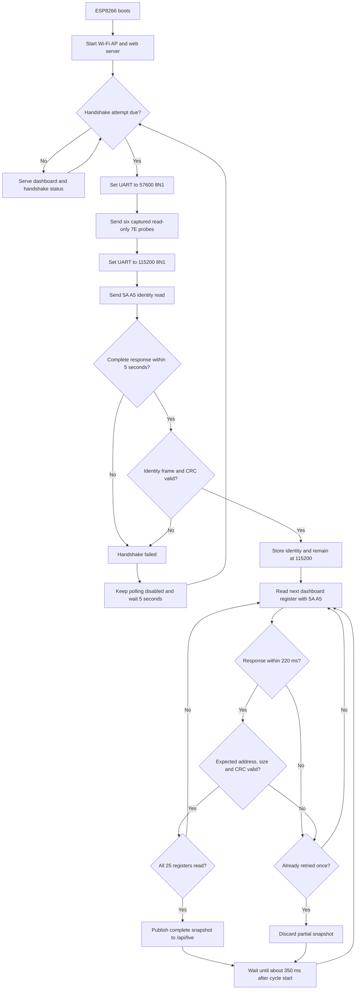

# ESP8266 controller protocol flow



```mermaid
sequenceDiagram
    participant ESP as ESP8266
    participant C as Controller
    participant Web as Browser

    ESP->>C: Six 7E probes at 57600 baud
    Note over ESP,C: No probe response is required
    ESP->>C: 5A A5 identity request at 115200 baud
    C-->>ESP: Identity plus CRC
    alt identity valid
        loop 25 dashboard registers at 115200 baud
            ESP->>C: 5A A5 read with encoded address and size
            C-->>ESP: Same address, value and CRC
        end
        ESP-->>Web: Publish complete dashboard snapshot
    else timeout or invalid identity
        Note over ESP: Polling remains disabled; retry after 5 seconds
    end
```

The CRC-valid `5A A5` identity response is the handshake gate. The preceding
`7E` probes reproduce the Windows application, but the working capture contains
no response to them. After identification the UART remains at 115200, and the
dashboard uses only individual read-only `5A A5` register requests.
