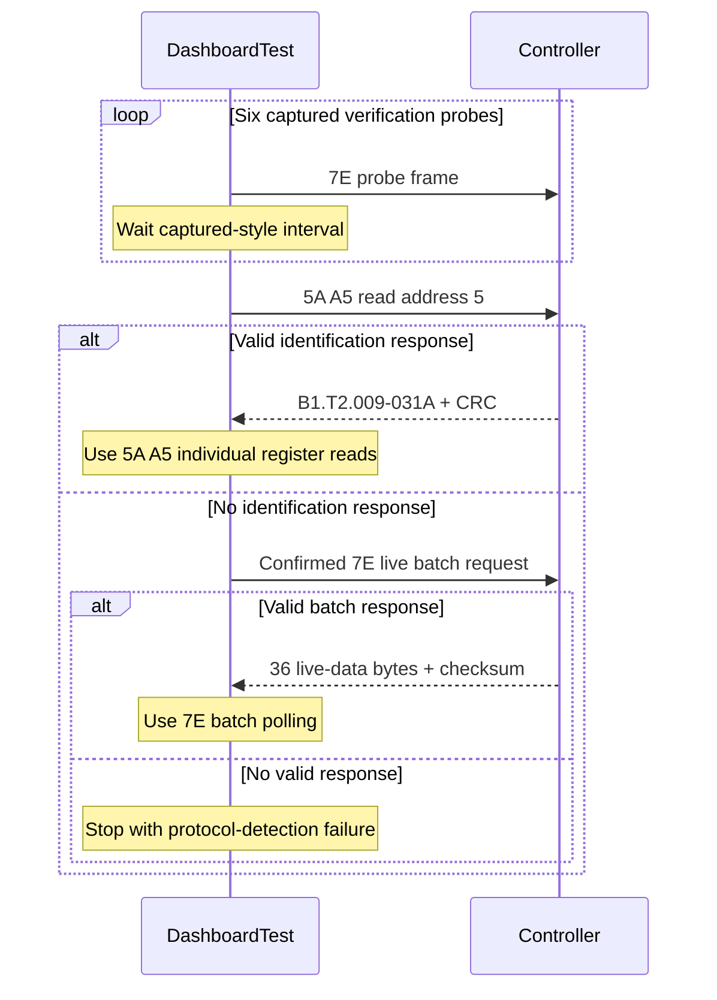

# DashboardTest flow diagram

`DashboardTest` is a read-only hardware console client. It opens a controller
COM port, reproduces the protocol-verification sequence captured in
`doc/HandShake.pcapng`, selects a supported read protocol, and prints dashboard
values once per second.

```mermaid
flowchart TD
    Start([Start DashboardTest]) --> Args{Arguments valid?}
    Args -- No --> Usage[Print usage and exit code 2]
    Args -- Yes --> Configure[Configure serial port<br/>115200 baud, 8N1<br/>no flow control<br/>DTR on, RTS off]

    Configure --> Open{Open COM port?}
    Open -- No --> OpenError[Print error and exit code 3]
    Open -- Yes --> Clear[Wait 150 ms<br/>clear input and output buffers]

    Clear --> Handshake[Send six captured read-only<br/>7E verification probes]
    Handshake --> IdRequest[Send 5A A5 identification read<br/>address 5, request up to 16 bytes]
    IdRequest --> IdResponse{Complete 5A A5<br/>response within 750 ms?}

    IdResponse -- Yes --> ValidateId{Header, address,<br/>terminator and CRC valid?}
    ValidateId -- No --> DetectionError[Print protocol-detection error<br/>and exit code 6]
    ValidateId -- Yes --> Select5A[Select 5A A5 register protocol<br/>display 14-character identity]

    IdResponse -- No --> BatchProbe[Send confirmed 84-byte<br/>7E batch-read request]
    BatchProbe --> BatchResponse{Complete 7E<br/>response within 750 ms?}
    BatchResponse -- No --> DetectionError
    BatchResponse -- Yes --> ValidateBatch{45-byte response,<br/>prefix, terminator and<br/>checksum valid?}
    ValidateBatch -- No --> DetectionError
    ValidateBatch -- Yes --> Select7E[Select 7E batch protocol]

    Select5A --> PollStart
    Select7E --> PollStart

    PollStart[Begin one-second polling cycle] --> StopCheck{Ctrl+C or requested<br/>iteration limit reached?}
    StopCheck -- Yes --> Summary[Print valid response summary]
    Summary --> Result{Every attempted<br/>poll succeeded?}
    Result -- Yes --> Success([Exit code 0])
    Result -- No --> PartialFailure([Exit code 5])

    StopCheck -- No --> Protocol{Selected protocol}

    Protocol -- 7E --> SendBatch[Send one 84-byte batch request]
    SendBatch --> ReadBatch[Read one 45-byte response]
    ReadBatch --> DecodeBatch[Validate additive checksum<br/>decode 36 data bytes]

    Protocol -- 5A A5 --> RegisterLoop[For each of 25 dashboard addresses]
    RegisterLoop --> SendRegister[Build and send read request]
    SendRegister --> ReadRegister[Read matching response]
    ReadRegister --> DecodeRegister[Validate address and<br/>CRC-16/CCITT-FALSE]
    DecodeRegister --> MoreRegisters{More addresses?}
    MoreRegisters -- Yes --> SendRegister
    MoreRegisters -- No --> Assemble[Assemble dashboard snapshot]

    DecodeBatch --> Display[Print timestamped dashboard values]
    Assemble --> Display
    Display --> Delay[Wait for remainder of<br/>one-second poll period]
    Delay --> StopCheck

    ReadBatch -. timeout or malformed .-> PollError[Print update error]
    ReadRegister -. timeout or malformed .-> PollError
    DecodeBatch -. invalid frame .-> PollError
    DecodeRegister -. invalid frame .-> PollError
    PollError --> Delay

    SendBatch -. serial I/O failure .-> SerialError[Print serial error<br/>and exit code 4]
    SendRegister -. serial I/O failure .-> SerialError
```

## Protocol-selection summary

## Safety boundary

Every transmitted application frame is read-only. The program does not contain
parameter-write, commit, reset, or other state-changing controller commands.
The six `7E` probes are reproduced exactly from the handshake capture; their
detailed semantics remain unconfirmed, so they are described as protocol
verification rather than controller initialization.
